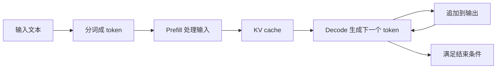

# 一次推理请求：从输入到逐个输出

本文是新增学习导读，不是原文逐句翻译。先以常见的自回归文本生成模型为例；并不是所有 AI 模型都按这种流程工作。

## Token 不是固定等于一个字

模型通常不直接把屏幕上的整句话当作一个单元。分词器把文本转换成 token，再映射成模型处理的标识。一个 token 可能是一个词、词的一部分、一个汉字或其他片段，具体由分词器决定。

所以“生成 100 个 token”不能直接理解成“输出 100 个汉字”。

## Prefill：先处理你已经给出的内容

你发来一个很长的问题，模型需要先处理输入内容。这个阶段通常叫 prefill，常译为预填充。

可以把它想成读题：先处理已有输入，并形成后续生成可以复用的 KV cache。这里的“读题”只是比方，不代表模型像人一样理解。

## Decode：在已有上下文上继续生成

之后模型逐步预测下一个 token，再把新 token 接到已有上下文后面，继续生成。这个阶段通常叫 decode。

这里的 decode 指生成阶段，不只是把字符编码转换回文字。一次响应可能以流式形式显示：不是等整段都生成完才给用户，而是陆续送出。

图是概念流程，不是具体引擎的完整线程或网络时序。

## KV cache：记下可复用的中间结果

KV 是 Key 和 Value 的缩写，来自注意力计算。对于常见因果自注意力生成，可以缓存先前 token 对应的 K/V，后续步骤复用，避免反复重算它们。

它更像计算用的草稿纸，不是聊天记录数据库，也不是模型长期记忆。它占用内存或显存；把缓存移到其他存储层，还会增加传输和访问成本。

在固定模型、批量大小和精度下，常规动态 KV cache 的容量通常随缓存 token 数近似线性增加；不能把它和注意力计算复杂度混为一谈。静态预分配和滑动窗口有不同的增长方式。

## 为什么要分开看两个阶段

Prefill 和 decode 的计算、内存访问特征不同。基础设施工程师可能把它们放在不同工作进程或节点上，这叫 PD disaggregation（预填充与解码分离）。

但分开以后需要传递状态、安排网络和路由，不是免费提速。先理解两个阶段，再读[PD 分离原文](../../../docs/inference/pd-disaggregation.md)，不要先背方案名字。

## 读完自测

- 为什么 token 不一定等于一个汉字？
- 为什么首个 token 很慢，不代表后续每个 token 都一样慢？
- 为什么 KV cache 不等于“记住用户偏好”的长期记忆？

下一步看[延迟与吞吐](./02-metrics.md)。

## 来源

- [仓库 PD 分离说明](../../../docs/inference/pd-disaggregation.md)
- [Hugging Face：How caching works](https://huggingface.co/docs/transformers/cache_explanation)
