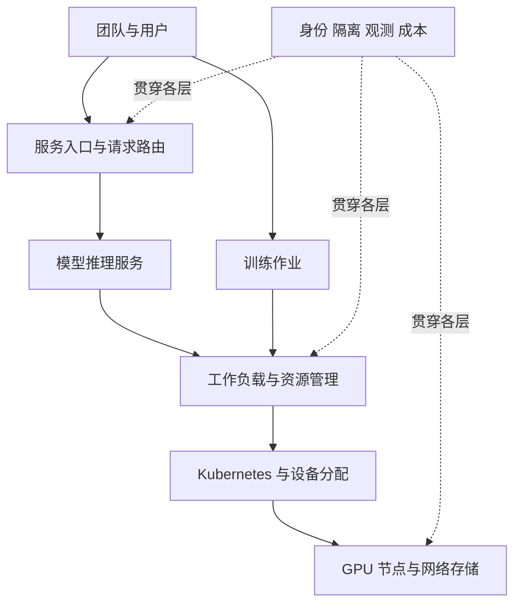

# 从组件到平台：不要把不同层的“调度”混在一起

本文是依据筛选后的上游讨论新增的学习增补，不是对某个未合并 PR 的原样搬运，也不是已验证的生产部署指南。

## 一张订单背后，有几种安排

继续用厨房的比方：门口的人决定把订单发给哪间厨房；店长安排哪位厨师处理；物业决定厨房开在哪一层、能用多少电。这些都像“安排”，却不是同一个系统在做。

| 层面 | 面向什么做决定 | 不负责什么 |
| --- | --- | --- |
| 请求路由 | 一次请求送给哪个模型服务或副本 | 不直接替 Kubernetes 放置 Pod |
| 引擎内部调度 | 哪些请求的计算合在一起、怎样使用显存 | 不等于跨团队配额治理 |
| 工作负载准入与排队 | 整个作业何时获准使用资源，怎样共享配额 | 不等于每个 Pod 的最终节点选择 |
| 集群调度 | Pod 放到哪个合适节点 | 不负责生成 token 或评判答案 |
| 设备分配 | 工作负载如何获得合适设备与访问配置 | API 稳定不等于每种设备驱动都生产可用 |

这些是概念职责。真实产品可能组合多个职责，边界要看具体实现。

## AI Factory 补的是“怎样经营整个平台”

[上游 PR #393](https://github.com/pacoxu/AI-Infra/pull/393)的有价值之处，是把多团队共享 GPU 的不同需求放在一张图上，而不是只介绍一个推理引擎。

初学时先问六个问题：

1. **机器能不能用**：节点和 GPU 驱动怎样准备，故障怎样发现？
2. **作业怎样上场**：训练和推理怎样声明资源，资源不够谁排队？
3. **数据怎样到位**：模型权重和训练数据怎样进入运行环境？
4. **团队怎样隔开**：身份、权限、网络和资源配额怎样划分？
5. **服务怎样接单**：模型服务的路由、扩缩容和发布怎样管理？
6. **运行结果怎样看见**：监控、日志、追踪和成本怎样归属到团队？

这六问是新增教学整理，不是 CNCF 认证标准，也不意味着必须采用同一套产品。

参考阅读：[CNCF 的 AI Factory 文章](https://www.cncf.io/blog/2026/08/27/building-an-ai-factory-on-kubernetes/)。本节不沿用其中任何具体版本或性能数字作为当前保证。

## DRA + Kueue：先学边界，再跑实验

[Issue #285](https://github.com/pacoxu/AI-Infra/issues/285)与[PR #387](https://github.com/pacoxu/AI-Infra/pull/387)适合用来学习“设备”和“队列”如何配合。

但 #387 使用 KWOK 模拟的范围主要是控制面。即使模拟中的排队、配额或抢占流程通过，也不能推出真实 GPU 算得更快、RDMA 网络达标、驱动已正确配置。

首批只把它挂为**待验证实验**，不搬海量原始采样，也不把作者的 PASS 写成我们复测通过。先读[DRA 原文](../../../docs/kubernetes/dra.md)和[调度原文](../../../docs/kubernetes/scheduling-optimization.md)，这些正文尚待后续完整翻译。

## Agent 扩展阅读：MCP 和 A2A 各接什么

筛选[PR #276](https://github.com/pacoxu/AI-Infra/pull/276)时发现，这两个概念有必要单独分清：

- **MCP**：定义 AI 应用怎样通过客户端连接服务器，获取工具、资源等上下文能力。比如助手调用一个查询工具。
- **A2A**：定义 Agent 之间怎样发现能力、交换任务或消息。比如一个旅行 Agent 与酒店 Agent 协作。

它们不是互斥替代品。一个 Agent 可以通过 A2A 协作，同时通过 MCP 使用工具。也不能把“用了协议”直接等同于“已经安全”：身份、权限、数据边界和审计仍要设计。

来源：[MCP 架构说明](https://modelcontextprotocol.io/docs/learn/architecture)、[A2A 官方说明](https://a2a-protocol.org/latest/topics/what-is-a2a/)。本次只增补职责区分，不展开未经实测的协议部署模板。

## 下一步

看[AIBrix 完整译文](../../../docs/inference/aibrix.md)，用具体项目检验自己能否指出控制面、网关、运行时和扩缩容分别在做什么。不要把文章中的历史版本标签误认成今天的最新发布。
