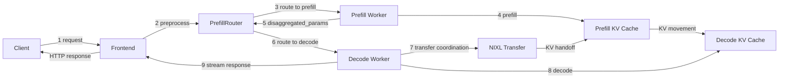

<a id="nvidia-dynamo-panorama-architecture"></a>
# NVIDIA Dynamo：全景架构

理解 [`Dynamo`](https://github.com/ai-dynamo/dynamo) 的最佳方式，是将其视为模型引擎之上的分布式推理编排层，而非另一个独立引擎。它在大型 GPU 集群中协调请求路由、KV 感知状态管理、自动扩缩容、部署和数据移动。

本页自上而下展示 Dynamo 生态全景，从流量入口一直到存储层级与硬件。

<a id="top-down-panorama"></a>
## 自上而下的全景

```mermaid
flowchart TB
    subgraph L0["Traffic And Application Entry"]
        U1["Users / Apps / API Clients"]
        U2["Agent Frameworks<br/>LangChain / NeMo Agent Toolkit"]
        U3["RL Frameworks<br/>VeRL / Slime / NeMo RL / Prime-RL / Miles"]
        U4["Multimodal / Video Apps<br/>FastVideo / DreamVerse-style pipelines"]
    end

    subgraph L1["Ingress And API Layer"]
        G1["Kubernetes Gateway / GAIE<br/>Gateway API Inference Extension"]
        F1["Dynamo Frontend<br/>OpenAI-compatible HTTP / KServe gRPC"]
    end

    subgraph L2["Dynamo Request Plane"]
        R1["Router<br/>KV-aware routing / load-aware routing"]
        R2["Global Router<br/>multi-pool / hierarchical routing"]
        P1["Prefill Pools"]
        D1["Decode Pools"]
        A1["Aggregated Pools"]
    end

    subgraph L3["Backend Runtime Adapters And Engines"]
        B0["Dynamo Backend Adapter Layer<br/>common.backend / worker / engine abstraction"]
        B1["vLLM Adapter + Workers"]
        B2["SGLang Adapter + Workers"]
        B3["TensorRT-LLM Adapter + Workers"]
        B4["TokenSpeed / Experimental Adapters"]
        B5["AITune<br/>non-LLM / generic PyTorch model tuning"]
    end

    subgraph L4["State Plane And Data Movement"]
        K1["KVBM<br/>KV Block Manager"]
        K2["KV Router Index / KV Events"]
        K3["NIXL / RDMA / KV Transfer"]
        K4["FlexTensor<br/>host-to-GPU weight streaming"]
        K5["LoRA / model version / sticky session metadata"]
    end

    subgraph L5["Control Plane And Orchestration"]
        C1["Profiler"]
        C2["AIConfigurator<br/>offline graph optimization"]
        C3["Planner<br/>SLA-based autoscaling"]
        C4["Global Planner"]
        C5["Dynamo Operator<br/>DGDR / DGD CRDs"]
        C6["Grove<br/>topology-aware gang scheduling"]
        C7["ModelExpress<br/>source discovery / P2P weight distribution"]
        C8["Run:ai Model Streamer<br/>storage-to-GPU tensor streaming"]
    end

    subgraph L6["Platform Services"]
        S1["Request Plane<br/>TCP / NATS"]
        S2["Discovery Plane<br/>Kubernetes / etcd / EndpointSlices"]
        S3["Event Plane<br/>NATS / ZMQ"]
        S4["Observability / health / fault tolerance"]
    end

    subgraph L7["Memory And Storage Tiers"]
        M1["GPU HBM KV / weights"]
        M2["Host DRAM / pinned memory"]
        M3["Local SSD / NVMe"]
        M4["Global File / Object Storage"]
    end

    subgraph L8["Hardware And Cluster Substrate"]
        H1["GPU Nodes<br/>H100 / H200 / B200 / GB200"]
        H2["Interconnect<br/>NVLink / NVSwitch / RDMA / NIXL fabric"]
        H3["Heterogeneous Accelerators<br/>Intel XPU / future LPU / mixed worker pools"]
        H4["Kubernetes / bare metal clusters"]
    end

    U1 --> G1
    U2 --> G1
    U3 --> G1
    U4 --> G1
    G1 --> F1
    F1 --> R1
    F1 --> R2

    R1 --> P1
    R1 --> D1
    R2 --> P1
    R2 --> D1
    R2 --> A1

    P1 --> B0
    D1 --> B0
    A1 --> B0

    B0 --> B1
    B0 --> B2
    B0 --> B3
    B0 --> B4
    B5 --> B0

    B1 --> K1
    B2 --> K1
    B3 --> K1
    B4 --> K1
    K1 --> K2
    K1 --> K3
    K4 --> B1
    K4 --> B2
    K4 --> B3
    K5 --> R1
    K5 --> R2

    C1 --> C2
    C1 --> C3
    C2 --> C3
    C3 --> C4
    C3 --> C5
    C4 --> C5
    C5 --> C6
    C7 --> B1
    C7 --> B3
    C8 --> C7
    M4 --> C8

    F1 --> S1
    R1 --> S1
    R2 --> S1
    B0 --> S1

    F1 --> S2
    R1 --> S2
    R2 --> S2
    B0 --> S2
    C5 --> S2

    R1 --> S3
    B0 --> S3
    K2 --> S3

    F1 --> S4
    R1 --> S4
    B0 --> S4
    C3 --> S4
    C5 --> S4

    K1 --> M1
    K1 --> M2
    K1 --> M3
    K1 --> M4
    K3 --> H2

    M1 --> H1
    M2 --> H1
    M3 --> H1
    M4 --> H4
    H1 --> H4
    H2 --> H4
    H3 --> H4
```




<a id="end-to-end-request-flow"></a>
## 端到端请求流程

官方 [Dynamo 流程图](https://github.com/ai-dynamo/dynamo/blob/main/docs/fern/assets/img/dynamo-flow.png)补充了仅看全景图无法展现的动态视角：单个解耦请求如何在系统中流转。

<a id="request-lifecycle-in-9-steps"></a>
### 请求生命周期的 9 个步骤

1. **请求**：客户端向 Dynamo Frontend 发送 HTTP 请求。
2. **预处理**：Frontend 验证输入、应用模板，并进行 token 化。
3. **路由到 prefill**：PrefillRouter 使用 KV 感知路由或负载均衡选择一个 prefill worker。
4. **Prefill**：prefill worker 计算提示词的 KV 状态。
5. **返回元数据**：prefill worker 返回包含传输元数据的 `disaggregated_params`。
6. **路由到 decode**：路由器将 prefill 结果注入 decode 请求，并选择一个 decode worker。
7. **KV 传输**：decode worker 协调从 prefill 侧直接移动 KV，通常通过 NIXL 完成。
8. **Decode**：decode worker 使用传输过来的 KV 缓存生成输出 token。
9. **响应**：token 通过 Frontend 流式返回客户端。

<a id="flow-diagram"></a>
### 流程图



<a id="how-the-flow-maps-to-the-panorama"></a>
### 流程如何映射到全景图

| 流程阶段 | 全景层 | 重要性 |
| --- | --- | --- |
| 请求 + 预处理 | 入口与 API 层 | Frontend 是 OpenAI 兼容流量的标准化入口 |
| Prefill 和 decode 路由 | Dynamo 请求平面 | Router 和 Global Router 决定 worker 放置与池选择 |
| KV 交接 | 状态平面与数据移动 | KVBM、KV 元数据和 NIXL 保持本地复用，并减少重复计算 |
| Token 生成 | 后端运行时适配器与引擎 | vLLM、SGLang 或 TRT-LLM 执行实际的前向计算 |
| 发现、指标、自动扩缩容 | 平台服务与控制平面 | worker 注册、planner 指标和扩缩容在请求路径旁运行 |

<a id="how-to-read-the-diagram"></a>
## 如何阅读此图

| 层 | 负责的内容 | 主要项目或组件 |
| --- | --- | --- |
| 流量入口 | 用户流量与上层框架 | 应用、智能体框架、RL rollout 框架 |
| 入口 | API 标准化与集群入口 | Gateway API Inference Extension、Dynamo Frontend |
| 请求平面 | 请求路由与 worker 选择 | Router、Global Router、prefill 池、decode 池 |
| 引擎层 | 在具体模型运行时上执行 | vLLM、SGLang、TensorRT-LLM、实验性适配器 |
| 状态平面 | KV 生命周期、复用与传输 | KVBM、KV 事件、NIXL、粘性会话元数据 |
| 控制平面 | 性能分析、规划、部署与扩缩容 | Profiler、AIConfigurator、Planner、Operator、Grove |
| 平台服务 | 传输、发现、可观测性 | TCP/NATS 请求平面、Kubernetes 或 etcd 发现、NATS/ZMQ 事件平面 |
| 模型与存储来源 | 模型注册中心，以及 KV 和权重的内存层次 | MatrixHub、HBM、主机 DRAM、本地 SSD、对象或文件存储 |
| 硬件 | 物理执行底座 | GPU 节点、NVLink、RDMA 网络、异构加速器 |

<a id="model-loading-plane-matrixhub-model-streamer-and-modelexpress"></a>
## 模型加载平面：MatrixHub、Model Streamer 与 ModelExpress

Dynamo 的模型加载路径包含三个互补层：

- **MatrixHub** 提供自托管、兼容 Hugging Face 的模型注册中心。Dynamo worker 可将 `HF_ENDPOINT` 指向集群内的 MatrixHub 服务，下载预先缓存的模型，而无需直接访问公共 Hugging Face。
- **Run:ai Model Streamer** 并发读取本地文件、S3、GCS 或 Azure Blob 中的 SafeTensors，通过有界 CPU 缓冲区将张量流式传输到 GPU 显存。在 vLLM 中，这通过 `runai_streamer`/`runai_streamer_sharded` 加载器提供。
- **ModelExpress** 协调集群内的模型来源。当兼容的 worker 已持有权重时，新 worker 可以通过 NIXL/RDMA 接收这些权重，而不必再次从存储读取完整模型。

因此，组合后的路径是：

```text
Hugging Face / private model -> MatrixHub -> HF-compatible download -> first worker
object / file storage ---------------------> Model Streamer ---------> GPU memory
source worker -----------------------------> ModelExpress + NIXL ---> later workers
```

MatrixHub 负责受治理的模型来源与下载路径；它不是 KV 缓存管理器，也不替代运行时加载。ModelExpress 不是模型注册中心，而 Model Streamer 并不会从冷启动关键路径中消除引擎初始化、JIT 编译、CUDA Graph 捕获或预热。
有关 `HF_ENDPOINT` 部署模式，请参阅官方 [MatrixHub 模型加载指南](https://docs.nvidia.com/dynamo/dev/kubernetes/model-deployment/model-loading/matrix-hub)；有关 vLLM/Dynamo 配置、比较矩阵和生产防护措施，请参阅 [Cache Offload 深入：Run:ai Model Streamer、Dynamo ModelExpress 与大模型加载加速](../blog/2026-05-18/2026-05-18-model-streamer-modelexpress-model-loading-zh.md)。

<a id="dynamo-snapshot-fast-worker-startup"></a>
## Dynamo Snapshot：快速启动 Worker

权重流式传输缩短的是*加载*；**Dynamo Snapshot** 则通过为已初始化的 GPU worker 保存检查点，并使用 CRIU + [`cuda-checkpoint`](https://github.com/NVIDIA/cuda-checkpoint) 恢复后续 Pod，缩短扩容时*加载之后的所有环节*。

| 路径 | 加速的内容 | 典型效果 |
| --- | --- | --- |
| Model Streamer / ModelExpress | 权重下载与 HBM 填充 | 加快首次/对等节点加载；仍需引擎初始化 |
| **Snapshot** | 从进程检查点进行完整热启动 | 恢复约 ~10 s，冷启动约 ~1 min（数量级） |

**流程：**

1. 启动一次 worker → 捕获已初始化状态（`DynamoCheckpoint` 或由 DGD 管理的自动检查点）
2. 将产物存储在命名空间本地的快照 PVC 上
3. 后续 `DynamoGraphDeployment` worker 通过 `checkpoint.enabled: true` 和可选的 `checkpointRef` 恢复

**运维说明：**

- 需要特权 `snapshot-agent`、占位运行时镜像，以及较新的 NVIDIA 驱动（文档提到 580.xx+）
- 跨节点恢复优先使用 ReadWriteMany 存储
- 预览版限制：主要面向单 GPU 的 vLLM/SGLang LLM worker；不能替代应用级睡眠/唤醒（参阅 llm-d FMA）

与 llm-d Fast Model Actuation 的完整比较、YAML 草案及约束：[Dynamo Snapshot（检查点 / 恢复）](./model-lifecycle.md#dynamo-snapshot-checkpoint--restore)。
上游：[docs/kubernetes/snapshot.md](https://github.com/ai-dynamo/dynamo/blob/main/docs/kubernetes/snapshot.md)。

<a id="kvbm-the-center-of-dynamos-state-plane"></a>
## KVBM：Dynamo 状态平面的中心

官方 [KVBM README](https://github.com/ai-dynamo/dynamo/blob/main/lib/bindings/kvbm/README.md) 明确指出，KVBM 不只是缓存容器。它是跟踪块生命周期、内存层级放置和跨节点移动的状态平面编排层。

<a id="kvbm-tiering-model"></a>
### KVBM 分层模型

| 层级 | 角色 | 存储内容 |
| --- | --- | --- |
| G1 | 设备池 | 驻留在 GPU HBM 中的 KV 块 |
| G2 | 主机池 | 用于卸载和召回的 CPU 固定内存 KV 块 |
| G3 | 磁盘池 | 由本地 SSD 或 NVMe 承载的 KV 块 |
| G4 | 远程存储 | 通过 NIXL 访问的共享对象或文件存储 |

这就是全景图将 KVBM 放在 worker 运行时与存储层级之间的原因：它使 `GPU -> host -> SSD -> remote` 成为受管理的内存层次，而不是一组临时拼凑的引擎专属功能。

<a id="kvbm-core-mechanics"></a>
### KVBM 核心机制

- **KvBlockManager / KvBlockManagerState** 负责块池、布局配置、指标和事件钩子。
- **TransferManager** 协调 Device→Host、Host→Disk、Host→Device 和 Disk→Device 等路径的异步移动。
- **块生命周期** 遵循从 `Reset` 到 `Partial`、`Complete` 和 `Registered` 的状态机，借此实现去重和按 `sequence_hash` 安全复用。
- **基于 RAII 的发布/移除句柄** 将块注册和移除推送到事件平面，使其他组件能够保持对可复用 KV 状态的一致视图。

<a id="why-nixl-matters-here"></a>
### NIXL 在这里为何重要

KVBM 使用 NIXL，不仅将其作为传输工具，还将其作为使远程 KV 可见性与传输具有可移植性的机制：

- 注册内存区域以供远程访问
- 序列化布局元数据，使具有不同 TP 布局的 worker 仍能就块几何结构达成一致
- 支持主机和磁盘接入流程，包括远程存储访问

这就是全景图中 NIXL 位于 KVBM 旁边，而不是引擎层之下的架构原因。

<a id="kvcr-an-emerging-router-hinted-kv-runtime"></a>
## KVCR：正在兴起的路由器提示驱动 KV 运行时

[`KV Cache Runner (KVCR)`](https://github.com/ai-dynamo/kvcr) 探索了一种更新的缓存管理边界。KV 感知路由器保留全局缓存清单和路由视图，而每个 KVCR 实例管理本地 DRAM、SSD，以及所配置的对象存储中的数据驻留。

KVCR 使用路由器提示查找可复用缓存数据，应用可插拔的准入、淘汰、放置和预备暂存策略，并将本地或点对点移动委托给 NIXL。可选的 `KVCR-Guard` 进程能够在引擎故障后保留 KVCR 所拥有的 DRAM，并使已提交缓存在重启期间保持可用。

KVCR 的设计不依赖特定框架或路由器。已公布的集成工作包括 TensorRT-LLM、vLLM、SGLang、Dynamo KV Router、`sgl-router` 和 `llm-d` 路由路径。该仓库仍在积极开发中，可能引入破坏性变更，尚不建议用于生产。

因此，KVBM 和 KVCR 同属广义的状态平面讨论，但目前应将它们视为两个独立、持续演进的组件进行评估，而不能假设其中一个能够直接替代另一个。

<a id="discovery-plane-how-components-find-workers"></a>
## 发现平面：组件如何找到 Worker

官方 [discovery-plane.svg](https://github.com/ai-dynamo/dynamo/blob/main/docs/fern/assets/img/discovery-plane.svg) 展示了一个简单但重要的划分：

- `Frontend`、`Router` 和 `Planner` 等**组件**需要进行**发现**
- **worker** 需要进行**注册**
- 实际的发现后端为 **Kubernetes 原生**或 **etcd**

<a id="discovery-backends"></a>
### 发现后端

| 后端 | 机制 | 运维含义 |
| --- | --- | --- |
| Kubernetes | `DynamoWorkerMetadata` CRD + `EndpointSlices` + API watch | 一等 K8s 原生发现路径 |
| etcd | `/services/{namespace}/{component}/{endpoint}` + 租约清理 | 默认的非 Kubernetes 发现后端 |

官方发现平面图中的两个细节值得强调：

1. **Kubernetes 发现不是边车功能。** 它是围绕 `DynamoWorkerMetadata`、Pod 就绪状态和 `EndpointSlices` 构建的真正发现后端。
2. **etcd 发现由租约驱动。** worker 注册到稳定的键层次结构中，并在租约到期后自动消失，借此清理故障后的陈旧端点。

这也解释了路线图中最有意义的转变之一：Dynamo 团队一直在减少对 `etcd` 和 `NATS` 的强制依赖，尤其是在 Kubernetes 部署的请求与发现平面中。

<a id="roadmap-context-10-hardening-to-20-expansion"></a>
## 路线图背景：从 1.0 加固到 2.0 扩展

如果将当前架构与 Dynamo 团队在 2026 年发布的两条路线图 issue 对照，就能形成不同的理解。

<a id="issue-5506-h1-26-roadmap"></a>
### Issue #5506：H1 '26 路线图

Issue [#5506](https://github.com/ai-dynamo/dynamo/issues/5506) 创建于 **2026-01-20**，衔接了 1.0 之前的版本与 1.0 发布阶段。它聚焦五个领域：

- 性能
- 生产级服务与扩缩容
- 核心路由器与 KV 缓存
- 智能体
- 多模态与扩散

从架构上看，该 issue 中最重要的信号是：

- **请求与发现平面解耦**：在更多部署中，`NATS` 和 `etcd` 变为可选，TCP 和 Kubernetes 原生发现承担更多基础路径
- **KVBM 深化**：HBM→host→local SSD 卸载被视为核心生产功能，issue 评论明确确认所指的就是本地 SSD 卸载
- **分布式 KV 方向**：路线图指出 P2P 网状网络加全局对象/文件存储，issue 评论确认跨节点、磁盘承载的存储在范围内
- **SGLang KVBM 支持**：issue 评论确认，“支持 SGLang”指的是 Dynamo KVBM 对 SGLang 的支持

<a id="issue-9208-toward-dynamo-20"></a>
### Issue #9208：迈向 Dynamo 2.0

Issue [#9208](https://github.com/ai-dynamo/dynamo/issues/9208) 创建于 **2026-05-06**，将定位从“交付 1.0”转向“扩展系统边界”。其声明的方向是覆盖除预训练以外几乎所有 GPU 使用场景。

这改变了全景图的解读方式：

- **智能体**从请求提示走向工作流感知调度与追踪
- **RL 后训练**使 Dynamo 成为 rollout 引擎，而非纯粹的推理层
- **Omni** 将运行时扩展到多模态、扩散、语音和视频
- **异构硬件**不再是对未来的好奇探索，而成为一等放置考量

Issue #9208 也解释了为什么图中的 `AITune`、`FlexTensor` 和 `ModelExpress` 被放在引擎层与控制层周围。它们不是偶然的附属项目，而是从 LLM 服务走向更广泛的推理和后训练平台这一演进路径的一部分。

<a id="surrounding-projects-and-their-roles"></a>
## 周边项目及其角色

- **推理引擎**：Dynamo 编排 [vLLM](https://github.com/vllm-project/vllm)、[SGLang](https://github.com/sgl-project/sglang) 和 [TensorRT-LLM](https://github.com/NVIDIA/TensorRT-LLM) 等引擎，而不是替代它们。
- **Kubernetes 编排**：[Grove](https://github.com/ai-dynamo/grove) 为多节点部署提供拓扑感知、成组调度的工作负载模型。
- **配置与规划**：[AIConfigurator](https://github.com/ai-dynamo/aiconfigurator) 离线探索候选部署方案，而 Planner 和 Global Planner 在线应用扩缩容决策。
- **模型分发、启动与内存**：[MatrixHub](https://github.com/matrixhub-ai/matrixhub) 提供兼容 HF 的私有模型来源，[ModelExpress](https://github.com/ai-dynamo/modelexpress) 降低集群内模型启动延迟，而 [FlexTensor](https://github.com/ai-dynamo/flextensor) 通过在主机内存与 GPU 显存间流式传输张量，扩展可容纳的模型规模。
- **KV 缓存运行时**：[KVCR](https://github.com/ai-dynamo/kvcr) 结合路由器提供的缓存提示、可插拔缓存策略、具有故障韧性的主机内存所有权，以及基于 NIXL 的跨层或对等节点传输。
- **非 LLM 覆盖**：[AITune](https://github.com/ai-dynamo/aitune) 将 Dynamo 扩展到通用 PyTorch 推理，尤其是定制的非 LLM 模型。

<a id="key-takeaways"></a>
## 核心要点

- Dynamo 是分布式推理的**系统层**，不是模型引擎的独立替代品。
- 它最具特色的能力位于**请求平面**，围绕 KVBM、正在兴起的 KVCR 工作和 NIXL 的**状态平面**，以及围绕 Planner、Operator 和 Grove 的**控制平面**。
- 周边 `ai-dynamo` 项目从三个方向扩展 Dynamo：**规划**、**Kubernetes 编排**和**内存 / 权重移动**。

<a id="references"></a>
## 参考资料

- [ai-dynamo/dynamo](https://github.com/ai-dynamo/dynamo)
- [Dynamo Snapshot（Kubernetes）](https://github.com/ai-dynamo/dynamo/blob/main/docs/kubernetes/snapshot.md)
- [NVIDIA Dynamo Snapshot 博客](https://developer.nvidia.com/blog/nvidia-dynamo-snapshot-fast-startup-for-inference-workloads-on-kubernetes/)
- [模型生命周期 — Dynamo Snapshot](./model-lifecycle.md#dynamo-snapshot-checkpoint--restore)
- [Dynamo KVBM README](https://github.com/ai-dynamo/dynamo/blob/main/lib/bindings/kvbm/README.md)
- [ai-dynamo/kvcr](https://github.com/ai-dynamo/kvcr)
- [KVCR 设计概述](https://github.com/ai-dynamo/kvcr/blob/main/docs/design_overview.md)
- [matrixhub-ai/matrixhub](https://github.com/matrixhub-ai/matrixhub)
- [Dynamo：从 MatrixHub 加载模型](https://docs.nvidia.com/dynamo/dev/kubernetes/model-deployment/model-loading/matrix-hub)
- [Dynamo 发现平面 SVG](https://github.com/ai-dynamo/dynamo/blob/main/docs/fern/assets/img/discovery-plane.svg)
- [Dynamo Issue #5506：H1 '26 路线图](https://github.com/ai-dynamo/dynamo/issues/5506)
- [Dynamo Issue #9208：迈向 Dynamo 2.0](https://github.com/ai-dynamo/dynamo/issues/9208)
- [ai-dynamo/grove](https://github.com/ai-dynamo/grove)
- [ai-dynamo/aiconfigurator](https://github.com/ai-dynamo/aiconfigurator)
- [ai-dynamo/modelexpress](https://github.com/ai-dynamo/modelexpress)
- [ai-dynamo/aitune](https://github.com/ai-dynamo/aitune)
- [ai-dynamo/flextensor](https://github.com/ai-dynamo/flextensor)
