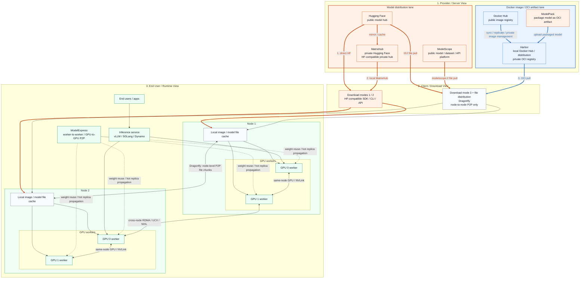
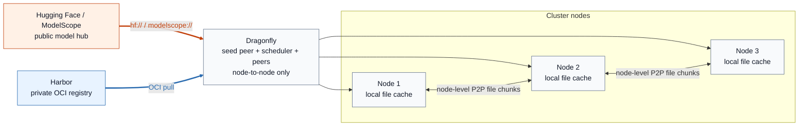
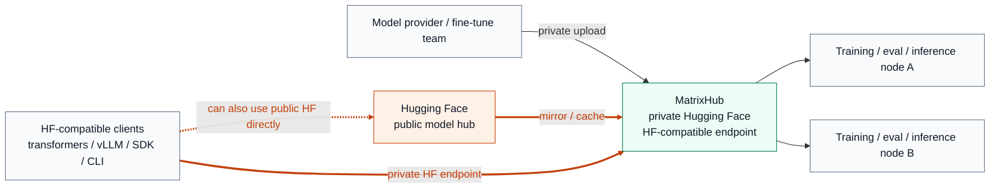
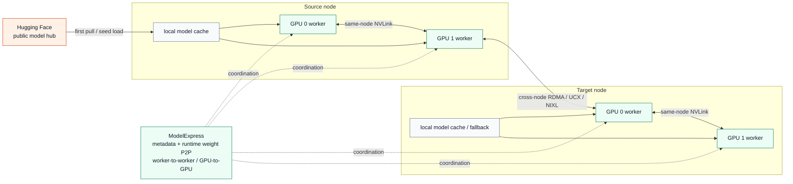

# 一张图看懂模型分发：Hugging Face、MatrixHub、Harbor、Dragonfly、ModelPack 和 ModelExpress

本页将几个经常被混淆的项目放在同一张图中，目的是区分**模型来源**、**私有仓库**、**集群分发**和**运行时加速**这几个层次。

> **译者注：** 本文忠实翻译所标注提交的原文快照；项目定位、能力及状态未独立验证。图中的代码与文字逐字保留原文，不代表对当前项目能力的确认。

## 用一张图展示技术栈

## 按角色阅读图示

- **提供方 / 服务端视角**：蓝色通道是 Docker 镜像 / OCI 制品路径。在这里，将 Harbor 理解为本地 Docker Hub / Distribution 风格的私有仓库最容易，而 ModelPack 是将模型转换为 OCI 制品的打包步骤。橙色通道是模型分发路径，Hugging Face、ModelScope 和 MatrixHub 位于这一侧。
- **下载视角**：在这个框架下有三种下载模式：`1. direct Hugging Face`、`2. local MatrixHub` 和 `3. OCI pull from Docker Hub / Harbor after OCI adaptation`。Dragonfly 位于文件分发层，仅处理节点级 P2P。
- **最终用户 / 运行时视角**：模型文件首先落入节点本地缓存，然后供给 GPU worker。ModelExpress 位于路径的后段，加速 worker 间和 GPU 间的权重复用，包括通过 RDMA 进行跨节点传输。

连线颜色也具有含义：

- **橙色连线**：HF 兼容或公共模型中心的下载路径
- **蓝色连线**：OCI 拉取路径
- **灰色节点间连线**：Dragonfly 节点级文件分块传播
- **绿色 GPU 间连线**：与 ModelExpress 相关的运行时权重共享路径

一句话概括：

- **三种模型下载模式**：
  `1. direct HF`、`2. local MatrixHub`、`3. OCI-adapted Docker Hub / Harbor`
- **两种 P2P 分发模式**：
  `Dragonfly = node-to-node only`、`ModelExpress = worker-to-worker / GPU-to-GPU`

## 专项参考图

### 1. Dragonfly 路径：Harbor 加公共模型中心

### 2. MatrixHub 路径：私有 Hugging Face 风格访问

### 3. ModelExpress 路径：首次拉取后的运行时权重共享

## 从左到右阅读图示

### 1. Hugging Face

Hugging Face 是公共上游模型中心。对于使用 `huggingface_hub`、`transformers`、`vLLM` 及类似客户端的许多训练和推理工作流，它都是默认来源。

### 2. 私有 Hugging Face

私有 Hugging Face 是一种**目标状态**，而不是单一产品。它意味着：

- 私有模型托管
- 访问控制与治理
- 与现有 HF 风格工作流低摩擦兼容
- 在企业或隔离网络环境内实现可预测的分发

### 3. MatrixHub

在这个技术栈中，MatrixHub 是实现上述目标状态最直接的路径。它充当 **HF 兼容的私有模型中心**，使团队在迁移到受治理的内部端点时，仍能保留 Hugging Face 的交互方式。

在实践中，MatrixHub 这一层负责：

- 私有模型仓库与生命周期治理
- 透明 HF 代理行为
- 按需缓存公共 Hugging Face 的内容
- 多区域或隔离网络分发工作流

### 4. ModelPack + Harbor + Dragonfly

这条路径有所不同：它是 **OCI 优先**，而非 HF 优先。

- `ModelPack` 提供基于 OCI 的模型制品打包/规范路径。
- `Harbor` 提供私有 OCI 仓库，包含 RBAC、签名、复制和保留等企业治理功能。一个有用的理解方式是，将其视为管理能力更强的企业本地 Docker Hub / Distribution 风格系统。
- `Dragonfly` 使用预热和 P2P 传输模式，加速从仓库到节点的分发。

这一技术栈能很好地解决**私有模型制品管理**问题，但它本身不提供原生兼容 Hugging Face 的端点。

### 5. ModelExpress

ModelExpress 位于路径的后段。它不是主要的模型中心，其主要职责是**集群内部运行时权重移动和冷启动缩减**。

这通常意味着：

- 协调推理集群中的缓存使用
- 减少重复的模型拉取和加载
- 支持 worker 间传输
- 加速从存储或缓存到服务 worker 的最后一段路径

官方文档重点介绍的是**集群内多节点协调**，而不是全局多集群控制平面。

## 最常见的架构模式

### 模式 A：公共 Hugging Face

当便利性比控制更重要时使用。

`Clients -> Hugging Face`

权衡：

- 工作流最简单
- 治理最少
- 重复从公网下载
- 不太适合隔离网络或受监管环境

### 模式 B：通过 MatrixHub 实现私有 Hugging Face

当现有 HF 工作流应保持几乎不变时使用。

`Clients -> MatrixHub -> Hugging Face or private storage`

权衡：

- 对 HF 优先的团队迁移成本最低
- 非常适合内部镜像与治理
- 与 Harbor 相比，和 OCI 优先的平台标准化契合度较低

### 模式 C：通过 Harbor + ModelPack + Dragonfly 实现私有模型仓库

当平台已经以 OCI 制品和 Kubernetes 为中心时使用。

`Build/package -> ModelPack -> Harbor -> Dragonfly -> cluster nodes`

权衡：

- 标准化与企业管控能力强
- 与 OCI 原生平台团队自然契合
- 如果用户期望原生 HF 语义，就需要更多工作流转换

### 模式 D：MatrixHub + ModelExpress

当同时需要**私有 Hugging Face 风格访问**和**更快的集群运行时加载**时使用。

`Clients -> MatrixHub -> cluster cache/source -> ModelExpress -> workers`

职责划分：

- `MatrixHub` 是上游权威记录系统和受治理的分发层。
- `ModelExpress` 是集群内的运行时加速层。

这种方式特别适合多集群环境：每个集群运行自己的运行时加速路径，共享的上游模型来源则保持版本和访问策略一致。

## 快速定位表

| 组件 | 主要层次 | 最适合 |
| --- | --- | --- |
| Hugging Face | 公共上游模型中心 | 公共模型发现与默认客户端工作流 |
| 私有 Hugging Face | 能力 / 目标状态 | 内部 HF 风格体验 |
| MatrixHub | 私有模型中心 | HF 兼容的内部分发与治理 |
| ModelPack | 打包/规范 | 基于 OCI 的模型制品定义 |
| Harbor | 私有仓库 | OCI 制品治理与复制 |
| Dragonfly | 集群分发 | 大规模节点级拉取加速 |
| ModelExpress | 运行时加速 | 集群内冷启动与权重传输优化 |

## 实用经验法则

- 如果问题是**“模型应该存在哪里、在哪里治理？”**，考虑 `MatrixHub` 或 `Harbor`。
- 如果问题是**“我们想要 HF 兼容的开发体验，还是 OCI 优先的制品工作流？”**，在 `MatrixHub` 与 `Harbor + ModelPack` 之间选择。
- 如果问题是**“如何减少集群冷启动和重复的权重移动？”**，考虑 `Dragonfly` 和 `ModelExpress`。
- 如果问题是**“如何在保留 HF 风格访问的同时，改善最后一段运行时加载？”**，结合 `MatrixHub` 和 `ModelExpress`。

## 参考资料

- [MatrixHub](https://github.com/matrixhub-ai/matrixhub)
- [Dynamo：从 MatrixHub 加载模型](https://docs.nvidia.com/dynamo/dev/kubernetes/model-deployment/model-loading/matrix-hub)
- [ModelExpress](https://github.com/ai-dynamo/modelexpress)
- [Harbor](https://goharbor.io/)
- [Dragonfly](https://d7y.io/)
- [ModelPack](https://modelpack.org/)
- [Hugging Face](https://huggingface.co/)
